# IdleMesh sprint plan

The development map for [PROJECT_PLAN.md](PROJECT_PLAN.md). Decisions (D-xx) are in
[changes.md](changes.md).

Sprints are **numbered, not dated**. Each one ends when its goal is met and demoed. Work at whatever
pace suits the moment.

- **Sprints 1–10** are planned in detail.
- **Sprints 11 and later** are placeholders, to be detailed about two sprints before they start.

## Working agreement

| | |
|---|---|
| Sprint length | No fixed length. A sprint closes when its goal is met, or when we decide to re-scope it. |
| Team (assumed) | 1–2 developers: Colin, with Michael as reviewer and approver |
| Ceremonies | Planning at the start, a demo and review at the end, and a one-line retro in the sprint log |
| Story IDs | `S<sprint>.<n>`. Carry-overs keep their ID and are marked ↪ in the next sprint. |

**Definition of done**

- Code merged to `main` with tests; `pytest`, `cargo test` and `clippy` green in CI.
- Docs updated, and a `changes.md` entry for any decision or behaviour change.
- **Observability (D-11):**
  - new code emits structured logs that carry the request, node and deployment IDs;
  - every new failure mode has an error code and a metric;
  - no prompt or response text ever appears in logs or telemetry.
- Demoed.

## Roadmap at a glance

```mermaid
flowchart LR
  subgraph P1["Phase 1 · Nodes, profiler, data"]
    S1["S1 Foundations,<br/>logging, CI"] --> S2["S2 Windows idle<br/>+ telemetry pipeline"] --> S3["S3 macOS/Linux idle,<br/>GPU profiler, Grafana"] --> S4["S4 Agent service,<br/>crash reports, test fleet"] --> S5["S5 Network probes<br/>+ graph"] --> S6["S6 Availability predictor<br/>· Phase 1 exit"]
  end
  subgraph P2["Phase 2 · Serving and the student service"]
    S7["S7 Replica serving,<br/>Ollama API, request metrics"] --> S8["S8 Campus queue, yield,<br/>recovery, fleet scaling"] --> S9["S9 Sign-in, roles,<br/>web chat"] --> S10["S10 Signed installers,<br/>update channel"]
  end
  subgraph Later["Placeholders"]
    S11["S11 Splits ·<br/>Phase 2 exit"] --> S12["S12 Security"] --> S13["S13 Pilot 1"] --> S14["S14 Admin and<br/>support dashboard"] --> S15["S15–17 Stage<br/>engine (D-09)"] --> S18["S18 Experiments"] --> S19["S19 Building<br/>pilot"] --> S20["S20 Paper"]
  end
  S6 --> S7
  S10 --> S11
```

| Sprint | Goal | Observability work in this sprint (D-11) | Serves |
|---|---|---|---|
| 1 | Approved, committed, CI green on 3 OSes; long-lead items started | Structured logging foundation, IDs that follow a request across components, error-code catalog | Foundations |
| 2 | Windows idle monitor, telemetry pipeline; **data collection starts** | Telemetry ingest; agent buffers telemetry on disk while offline | P1: idle data |
| 3 | macOS and Linux idle, GPU and backend profiler, Grafana | Node health metrics and dashboards | P1: profiler, ≥2 OSes |
| 4 | Agent runs as a service; 3–5 test machines collecting data | Crash reports, remote diagnostic bundle, log rotation | P1: ≥5 nodes |
| 5 | Network probes, network graph, clusters | Network metrics and probe-failure errors | P1: graph and clusters |
| 6 | Availability predictor in placement; **Phase 1 exit** | Predictor accuracy tracked as a metric | P1 exit |
| 7 | Single-node replica serving, Ollama API, customer-supplied models | Per-request performance events and stage timings | P2: serving |
| 8 | Campus-scale queue, yield-don't-leave, request-level recovery, fleet scaling | Recovery, yield and drain metrics; scheduled benchmark canaries; alerts | P2: fault tolerance |
| 9 | University sign-in, roles, web chat MVP | User-facing error IDs that support can look up | Student service |
| 10 | Signed one-click installers | Version inventory, staged rollout, remote config and rollback | D-07, D-08 |
| 11+ | Placeholders | Support dashboard (S14), opt-in vendor support channel (Phase 4) | P2 exit, P3, P4 |

## Long-lead items (start in sprint 1, track every sprint)

These depend on other people and can take a long time. **On the back burner for now** (Colin's call,
after Sprint 1): engineering goes first, and each item is picked up before the sprint that needs it.

| Item | Needed by | Owner | Status |
|---|---|---|---|
| Michael's approval of the restructure and D-01 to D-12 | S1 | Colin → Michael | **Done** (2026-11-19) |
| Test fleet: 3–5 machines (≥1 Mac, ≥1 NVIDIA PC, ≥1 CPU-only) with owners' consent | S4 | Colin | **Started:** dev machines on all three OSes now (Windows PC, macOS laptop, Linux server over SSH). 8 laptops held back for later sprints; their OS and GPU mix to record in [docs/long-lead.md](docs/long-lead.md) |
| Campus IT: workstation opt-in policy, firewall rule for the tunnel port, and the antivirus/EDR product used | S4 (policy), S10 (antivirus) | Colin | Open |
| University privacy office: student data (FERPA), retention, **and what operational telemetry may be collected** (D-11) | S4 (telemetry), S9 (chat) | Colin | Open |
| Campus single sign-on: an OIDC or SAML app registration with IT | S9 | Colin | Open |
| Code-signing certificates: Windows Authenticode and an Apple Developer ID | S10 | Colin / FAIRlab | Open |
| University IP and tech transfer conversation; written agreement on Michael's code | Before any commercial step | Colin, Michael | Open |

---

## Sprint 1 · Foundations, logging and approval

**Goal:** the reworked repo is approved, committed and green in CI on Windows, macOS and Linux. The
logging foundation is in place before any new feature code, and every long-lead item has started.

| ID | Story | Acceptance |
|---|---|---|
| S1.1 | Michael reviews changes.md, the overview page and the plan | Approval or requested changes recorded in each changes.md entry's Status line |
| S1.2 | Commit and push the restructure | On `main`; history kept (`git log --follow` works on moved files) |
| S1.3 | Fix the Windows key-permission gap: restrict the coordinator's private key to its owner with an ACL | The key test passes on Windows (adapted to check the ACL) |
| S1.4 | Integration tests find `idlemesh-agent.exe` on Windows | They run on Windows when the build exists, instead of being skipped |
| S1.5 | CI with GitHub Actions on a Windows, macOS and Ubuntu matrix: `pytest`, `cargo test`, `cargo clippy` | Green on all three; required before merging |
| S1.6 | **Structured logging, agent:** the `tracing` crate, JSON lines, levels, a size-capped rotating file, and spans carrying `node_id`, `deployment_id`, `request_id` | Existing `eprintln!` and log calls converted; a log line is parseable JSON |
| S1.7 | **Structured logging, coordinator:** JSON logs carrying the same IDs; capture llama-server and rpc-server logs with the IDs attached | One request can be followed from coordinator to agent to worker by its `request_id` |
| S1.8 | **Error-code catalog** (`docs/error-codes.md`): stable codes shared by coordinator and agent (DIFA codes such as `WORKER_LOST` and `PARTITION_MISMATCH` carry over) | Every error path returns or logs a catalogued code |
| S1.9 | **Redaction rules:** no prompt or response text, tokens, keys or usernames in file paths; tests enforce them | A test fails if a known secret or prompt string reaches a log |
| S1.10 | `docs/licenses.md` first pass: Python and Rust dependencies, llama.cpp, and the observability stack (D-11 licence notes) | Every dependency listed with its licence and obligations |
| S1.11 | Draft `proto/` contracts, including telemetry, crash and diagnostic messages; review only | Reviewed; they become the shape of the HTTPS/JSON payloads now (D-06) |
| S1.12 | `config/example.site.yaml`: idle thresholds, probe schedules, caps, log level, telemetry interval, retention, `org_id`/`site_id` | Loaded by the coordinator |
| S1.13 | Start every long-lead item in the table above | Each has a named contact and a first message sent |

**Demo:** CI green on three OSes; one request traced end to end through JSON logs.

**Status at sprint review** (details in [changes.md](changes.md), "Sprint 1"):

| ID | Status |
|---|---|
| S1.1 | ✅ Approved by Michael (2026-11-19); recorded in every changes.md entry |
| S1.2 | ✅ Merged to `main` (PR #1) with history kept |
| S1.3 | ✅ Owner-only ACL on Windows for coordinator keys **and** the agent's state file; tests check the ACL |
| S1.4 | ✅ Agent-driven tests now run on Windows (74 → 102 tests passing, 0 failing) |
| S1.5 | 🟡 CI green on `main`, **Windows only**: macOS and Ubuntu were taken out of the matrix to get the first merge through. Still open: add them back now that a Mac and a Linux server are available for checking failures, and make CI required before merging (`main` is not protected yet) |
| S1.6 | ✅ Agent JSON log file with rotation, codes and IDs. IDs come from a process-wide context rather than `tracing` spans: one agent serves one node, and the context also covers the tunnel and prefetch threads |
| S1.7 | ✅ Coordinator JSON logs; a request is followed from coordinator to agent by `request_id` (`scripts/trace.py`, tested end to end). Worker output is tagged with the deployment and active requests; checked on hardware once a llama.cpp build is on the dev machines |
| S1.8 | ✅ `contracts/error-codes.json` + generated `docs/error-codes.md`; tests on both sides |
| S1.9 | ✅ Redaction on every line, enforced by tests in both components |
| S1.10 | ✅ `docs/licenses.md` generated; all 219 dependencies permissive; CI checks it |
| S1.11 | ✅ Drafts in `proto/idlemesh/v1/` accepted as the starting shape. A separate review was dropped: Colin has explicit permission to proceed. They change as the code needs |
| S1.12 | ✅ `config/example.site.yaml`, loaded and validated by the coordinator |
| S1.13 | ⏸ Deferred. Approval done and dev machines on all three OSes in hand. Items 3–7 are on the back burner while engineering moves ahead; drafts stay in [docs/long-lead.md](docs/long-lead.md) |

**Demo status:** the end-to-end trace works (`scripts/trace.py`); CI runs on Windows, macOS and
Ubuntu and is required before merging to `main`.

**Sprint 1 is closed.** The long-lead items (S1.13) carry over as deferred, not blocking.

## Sprint 2 · Windows idle monitor and telemetry pipeline

**Goal:** a Windows workstation reports idle samples that the coordinator stores, reliably, even
through outages. Idle-data collection starts and keeps running from here on.

| ID | Story | Acceptance |
|---|---|---|
| S2.1 | Agent `idle` module (Windows): `GetLastInputInfo` → `seconds_since_input`, session active or locked, CPU utilisation | Unit tests; a manual check shows idle seconds reset on input |
| S2.2 | Windows power status probe (replaces "unknown") | AC, battery and percentage correct on a laptop |
| S2.3 | `IdleSample` telemetry (PROJECT_PLAN §6): batched, `schema_version`, pseudonymized `node_id`, `org_id`/`site_id` | Coordinator ingest endpoint and SQLite tables; schema tests |
| S2.4 | **Telemetry pipeline:** one ingest path for samples, events and errors; **on-disk buffering in the agent** when the coordinator is unreachable (bounded size, oldest dropped first, drops counted) | Unplug the network for an hour → no data lost within the buffer limit |
| S2.5 | Node states `idle / active / sleeping / draining / serving` | State machine tests; state changes logged as events |
| S2.6 | Local consent record v0, covering idle data **and** diagnostics (D-11) | Coordinator refuses telemetry without consent |
| S2.7 | Leave the dev machine collecting continuously | Data accumulating for the Phase 1 exit |

**Demo:** the dev machine's idle timeline; an outage test with a full backfill.

**Status** (details in [changes.md](changes.md), "Sprint 2"):

| ID | Status |
|---|---|
| S2.1 | ✅ Idle seconds, lock state and CPU use; unit tests. `idlemesh-agent idle --watch` for the manual check on the dev PC |
| S2.2 | 🟡 Decoding unit-tested; reads AC on the dev laptop. The on-battery check is deferred (Colin, 2026-11-20): most nodes will be plugged in |
| S2.3 | ✅ Ingest endpoint, SQLite tables, schema version, pseudonymous node key (D-16), `org_id`/`site_id`, retention |
| S2.4 | ✅ On-disk buffer, capped, oldest dropped first, drops counted; end-to-end outage test passes with no gap. Error events still travel as log lines; `ErrorEvent` records ↪ S3.5 with node health |
| S2.5 | ✅ State machine and sleep detection with tests; changes logged and sent as events |
| S2.6 | ✅ Consent record v0 (D-15); the coordinator refuses telemetry without it |
| S2.7 | 🟡 Runbook and timeline script ready ([docs/runbooks/dev-collection.md](docs/runbooks/dev-collection.md)); **start collection on the dev PC** |

## Sprint 3 · macOS and Linux idle, GPU profiler, Grafana

**Goal:** idle data, hardware profiles and node health from all three OSes, visible in Grafana.

| ID | Story | Acceptance |
|---|---|---|
| S3.1 | macOS idle: IOKit `HIDIdleTime`; lid and sleep events | Tested on the Mac |
| S3.2 | Linux idle: logind `IdleHint`, with a fallback for headless machines | Tested on Ubuntu |
| S3.3 | Hardware profiler: CPU, RAM, unified memory, GPU model and VRAM (NVML or `nvidia-smi`; Metal on Mac) | Profile in the device registry |
| S3.4 | Backend detection (CUDA, Metal, Vulkan, CPU), plus the existing llama-bench decode probe | Backends listed per node; probe result used by placement |
| S3.5 | **Node health metrics:** CPU, GPU, memory, temperature where available, disk free for the model cache, agent uptime, worker restarts, cap kills, tunnel errors | `NodeHealthSample` stored; counters never reset silently |
| S3.6 | Grafana: node list, idle heatmap by hour of the week, node health panels, error-rate panel by error code | Dashboards committed under `deploy/` |

**Demo:** Grafana showing data from 2 or more OSes, including an induced error appearing by code.

**Status** (details in [changes.md](changes.md), "Sprint 3"):

| ID | Status |
|---|---|
| S3.1 | 🟡 IOKit `HIDIdleTime`, CoreGraphics lock state and lid (`AppleClamshellState`) through the C APIs; lid changes sent as events, sleep found as a wall-clock gap (S2.5). Builds and passes on CI's macOS runner. On the MacBook (M1 Pro, macOS 15.5): seconds since input match `ioreg`'s `HIDIdleTime` (173 s and 173.8 s), lid open and unlocked read correctly, and the agent reports Metal. **Still to watch:** a lock and a lid close changing the readings |
| S3.2 | ✅ logind for local graphical sessions; headless fallback from terminal input and wtmp. Verified on the Linux server (headless: idle time matched its last terminal input) |
| S3.3 | ✅ CPU, RAM, unified memory, GPUs with VRAM (`nvidia-smi`, `system_profiler`, Windows CIM, Linux sysfs) in every heartbeat and the device registry. Verified on the dev PC (RTX 3500 Ada) and the Linux server (2× RTX A6000) |
| S3.4 | ✅ CUDA, Metal, Vulkan and CPU detected per node; the existing decode probe still feeds placement |
| S3.5 | ✅ `NodeHealthSample` and per-code error counts from agents; the coordinator counts its own codes. Counters restart only with `agent_uptime_s`. Diagnostics consent required |
| S3.6 | ✅ [deploy/grafana/](deploy/grafana/): Docker Compose, Infinity data source on a read-only metrics API (D-18), generated dashboard. Demo run with Windows and Linux nodes and an induced error shown by code |

## Sprint 4 · Agent as a service, crash reports, diagnostics; test fleet live

**Goal:** 3–5 real workstations run the agent as a service, and when something breaks on one of them,
we can find out why without visiting it.

| ID | Story | Acceptance |
|---|---|---|
| S4.1 | Run the agent as a service: Windows service, launchd daemon, systemd unit (install scripts for now) | Survives a reboot with no logged-in terminal |
| S4.2 | Enrollment from a config file (groundwork for the installer wizard) | Service starts and enrolls using `config.yaml` |
| S4.3 | **Crash reports:** an agent panic hook records the backtrace, version, build hash, OS and redacted config, and uploads it on the next start; worker crashes (llama.cpp exit codes and the log tail) are reported the same way | A forced panic and a killed worker each appear on the coordinator with their context |
| S4.4 | **Remote diagnostic bundle:** an admin requests diagnostics → the agent packages recent logs, versions, probes, health and redacted config → uploads to the coordinator. Requires the node's consent. | A bundle is retrieved from a test-fleet node without touching it |
| S4.5 | Remote log level: an admin can raise one node's log level for a limited time, after which it reverts automatically | A debug window opens and closes automatically |
| S4.6 | Deploy to the test fleet, following the campus IT guidance | ≥3 nodes reporting; ≥5 by the end of S6 |
| S4.7 | Re-run the legacy three-machine test on current `main` (handoff backlog item 1) | Heartbeat fix confirmed on hardware; drain checks 4a–4f recorded |
| S4.8 | OS memory limits (Windows Job Objects, Linux cgroups) to back up the 250 ms watchdog | The worker can't exceed its cap, even briefly |
| S4.9 | **Contribution governor v0 (D-12):** a level from 0.0 to 1.0, from the idle-duration ramp, time windows (overnight or weekends) and admin and owner settings; applied through CPU priority, thread count and memory cap; reported in heartbeats and `IdleSample` | Level rises with idle time and drops within about 1 s on input; every level change is logged with its reason |

**Demo:** crash a worker on a fleet machine and diagnose it entirely from the coordinator.

**Status** (details in [changes.md](changes.md), "Sprint 4"):

| ID | Status |
|---|---|
| S4.1 | 📐 Design only, by decision (Colin, 2026-11-20: no auto-start until much later): [docs/design/agent-service.md](docs/design/agent-service.md). Service plus a session helper on Windows and macOS |
| S4.2 | ✅ `idlemesh-agent run --config node.yaml` enrolls on first start, then runs; tested end to end |
| S4.3 | ✅ Agent panics and worker crashes become crash reports (backtrace or exit status, last output, version, build hash, redacted config), uploaded when reachable. Forced panic and killed worker both tested; worker restarts back off |
| S4.4 | ✅ Bundle requested by an admin, built and uploaded by the agent. Retrieved from the Linux server without touching it |
| S4.5 | ✅ Debug window opens, writes debug lines, and closes by itself (also on the node if the coordinator is unreachable) |
| S4.6 | ✅ Dev PC, Linux server and MacBook reporting (3 nodes; the Linux server and the Mac through SSH tunnels: see [docs/runbooks/test-fleet.md](docs/runbooks/test-fleet.md)). The Mac enrolled from a node config file |
| S4.7 | ✅ Three-machine run with llama.cpp v0.9.0 (Windows CPU, Linux CPU, Mac Metal as head): ready after 32 s, 10/10 requests, drain checks 4a–4f all pass with the Mac as the target. **Open:** prediction error −42.8% (−34.5% on two machines; target ±30%), because CPU workers have no decode probe and are planned from defaults (moved to S5) |
| S4.8 | ✅ Job Object on Windows (also ends the worker if the agent dies), `RLIMIT_DATA` on Linux; refusal tested on both. macOS keeps the watchdog |
| S4.9 | ✅ Governor v0 with idle ramp, time windows and owner ceiling; applied through priority, threads and the offered memory; logged with reasons; unit-tested. On hardware: input switches the reason to `user_activity` within the 1 s check and holds the yield level, and going on battery drops it to 0 (`power`). A drop from a high level on input is not yet seen, because the dev PC slept before its 30-minute ramp got far |

## Sprint 5 · Network probes and the network graph

**Goal:** a live latency and bandwidth graph with automatic clusters.

| ID | Story | Acceptance |
|---|---|---|
| S5.1 | Net prober: RTT from each node to candidate heads on the real data path, scheduled and rate-limited | `NetEdge` rows with p50/p95 |
| S5.2 | Built-in bandwidth test through the tunnel, instead of iperf3, so nodes need no extra software (D-07) | Mbps per edge; runs off-hours by default |
| S5.3 | Fill `link_mbps` in placement so the per-token traffic term counts (handoff backlog item 2) | The Wi-Fi under-prediction from Rounds 5 and 7 re-checked |
| S5.4 | Coordinator `graph/`: networkx graph; clusterer v0 (threshold → connected components) | Clusters recomputed automatically; unit tests |
| S5.5 | Network metrics and errors: probe failures by code, link degradation events | Grafana edges and clusters view, with probe health |
| S5.6 | Run the decode probe on every worker, CPU ones included, so placement stops planning them from defaults (found in S4.7) | The three-machine run's speed prediction within ±30% |

**Demo:** the cluster map compared with the real building layout.

**Status** (details in [changes.md](changes.md), "Sprint 5"):

| ID | Status |
|---|---|
| S5.1 | ✅ Coordinator-relayed (D-25): agents report their subnet; the coordinator stores each node's heartbeat RTT to itself only on change or daily; same-subnet pairs get relayed links; clusters never span subnets (D-24). Unit and API tests; the agent's subnet checked on the dev PC. Peer probes (event-driven, off by default) follow once two reachable machines are available |
| S5.2 | ✅ Built-in bandwidth test served by the agent's tunnel (`agent/src/bulk.rs`), so nodes need nothing extra (D-07): the coordinator times 8 MiB each way after a 1 MiB warm-up and keeps the slower direction. Due on events (first worker start, network change) as soon as the governor allows, otherwise weekly in off-hours (D-27); admin trigger `POST .../devices/{id}/bandwidth-test`. Live-tested against a capped relay (50, 60, 150, 200 Mbps, all within 1-2%). **Real links wait for the machines:** [sprint5-hardware-checks.md](docs/runbooks/sprint5-hardware-checks.md) step 1 |
| S5.3 | 🔧 Placement fills `link_mbps` from the tunnel test (the link to the head, as the follow-up asked), adds its per-token traffic to the stage and to the latency score, and times an untested link at load. Loopback: a 60 Mbps link is now predicted at 127 ms/token instead of 19 (measured 166, −23%). **Acceptance (the Wi-Fi rounds re-checked) waits for the machines:** step 2 of the runbook |
| S5.4 | ✅ `graph/` package: links from measurements (the worse direction counts), threshold rule (median RTT ≤ 5 ms, and ≥ 100 Mbps once bandwidth is measured), connected components, cluster IDs that survive a node joining or leaving. Recomputed every 5 minutes; changes logged. `net_edge` telemetry records and the admin `GET .../network` view. networkx graph (D-22). Unit and API tests; real measurements wait for S5.1 |
| S5.5 | ✅ `NET_PROBE_FAILED`, `NET_PROBE_REFUSED` and `LINK_DEGRADED` (bandwidth below half the last test, or a heartbeat RTT jump on the same network); network metrics endpoints; Grafana **Network** row: node-graph cluster map, nodes-and-links table, bandwidth and RTT over time, probe health by code. Unit and API tests; **the panels have not been rendered in Grafana yet** (runbook step 3) |
| S5.6 | 🔧 Every worker probes by default: llama-bench beside the worker, the reference model offered by the coordinator and verified by SHA-256, the benchmark only while the governor allows contribution (D-23). Live-tested on the dev PC. S5.2 and S5.3 are now built, so the acceptance is the three-machine re-run in step 2 of the [runbook](docs/runbooks/sprint5-hardware-checks.md). Estimated before S5.3: the two-machine run goes from −34.5% to about −26%; the three-machine gap is the link traffic S5.3 now counts |

## Sprint 6 · Availability predictor; Phase 1 exit

**Goal:** placement prefers nodes likely to stay idle; Phase 1 exit criteria met.

| ID | Story | Acceptance |
|---|---|---|
| S6.1 | `predictor/`: per-node idle probability by hour of the week | Probability of staying idle for the next N minutes, per node |
| S6.2 | Offline evaluation (Brier score, calibration) | Notebook in `experiments/analysis/` |
| S6.3 | Placement: an availability term in filter-and-score (C1 v0), plus capacity weighted by contribution level (D-12) | Unit tests; both terms appear in the placement explanation |
| S6.4 | **Predictor accuracy as a live metric:** predicted vs. actual idle time per node, tracked over time | A Grafana panel shows drift |
| S6.5 | Dataset export: anonymised samples and edges, with `docs/telemetry-schema.md` | Reproducible export script |
| S6.6 | **Phase 1 exit review** with Michael: ≥5 nodes, ≥2 OSes, graph and clusters auto-update, ≥2 weeks of idle data | Recorded in changes.md |

**Demo:** placement choosing the more-likely-idle node; the predictor accuracy panel.

**Status** (details in [changes.md](changes.md), "Sprint 6"):

| ID | Status |
|---|---|
| S6.1 | ✅ `predictor/`: per node, per hour of the week, the chance of staying idle for 30, 60 and 120 minutes, shrunk towards the node's and the fleet's rates; refitted hourly; admin endpoint `GET .../devices/{id}/availability` (D-28). Unit and API tests |
| S6.2 | 🔧 `predictor/evaluate.py` (Brier, skill, calibration), `experiments/analysis/predictor_eval.py` and `predictor-evaluation.ipynb`. Run on a synthetic fleet only ([results](experiments/analysis/results/predictor-eval-synthetic-seed1.md)): **the real evaluation waits for two weeks of real samples** |
| S6.3 | ✅ Availability score component, and capacity weighted by contribution level (D-28, D-29); both appear in each score's `components` and `inputs` and in each stage. Unit tests, and an API test where the deployment picks the steadier node |
| S6.4 | 🔧 Accuracy scored out of sample every 6 h into `predictor_accuracy`; `GET /api/v1/metrics/predictor-accuracy`; Grafana row with predicted vs. actual, drift and Brier by node. API tests; **the panels have not been rendered in Grafana yet** |
| S6.5 | ✅ `scripts/export_dataset.py` and [docs/telemetry-schema.md](docs/telemetry-schema.md): consent-filtered, seed-aliased, reproducible (D-30). API tests |
| S6.6 | ⏳ Needs ≥5 nodes on ≥2 OSes and two weeks of idle data: waits for the machines |

## Sprint 7 · Replica serving, Ollama API and request metrics

**Goal:** a request is answered by a whole model on one idle node through Ollama- and
OpenAI-compatible endpoints, and every request leaves a performance record.

| ID | Story | Acceptance |
|---|---|---|
| S7.1 | Agent manages a whole-model `llama-server` worker (replica path, D-05) behind the mTLS tunnel | Starts and stops with idle state; memory cap enforced |
| S7.2 | Router v1: model fits one node → replica; otherwise → split | Decision recorded in the request trace |
| S7.3 | Scheduler dispatches across many deployments | Two replicas serve two queued requests in parallel |
| S7.4 | Ollama endpoints `/api/chat`, `/api/generate`, `/api/tags`, `/api/pull` | Works with an unmodified Ollama client |
| S7.5 | Customer-supplied models (D-10): licence shown, accepted and audited when a model is added | Pulling without accepting is refused |
| S7.6 | **`InferenceEvent` for every request:** queue wait, time to first token, tokens per second, tokens in and out, per-stage timings, predicted vs. actual latency, outcome and error code, model, nodes, versions | Grafana panels for p50/p95/p99 by model and route |
| S7.7 | Measure `-np` batching on one node and over RPC (D-04 follow-up) | Throughput against N, recorded in `experiments/` |
| S7.8 | **Throttle control in the worker (D-12):** change thread count at run time and pause between decode steps (GPU duty-cycling). Check upstream llama.cpp options first; otherwise use a small patch or wrapper, built in CI with the rest. | At the minimal level GPU use is ≈2–5% while the request still progresses; a measured foreground app stays smooth |

**Demo:** an Ollama client chatting through IdleMesh, with its request visible in the metrics.

## Sprint 8 · Campus-scale queue, yield, recovery, fleet scaling and canaries

**Goal:**
- The queue serves many users fairly.
- A node whose user returns **yields instead of leaving**, and no request is lost.
- The fleet scales with demand.
- Slowdowns are caught automatically.

| ID | Story | Acceptance |
|---|---|---|
| S8.1 | Scale the fair queue: configurable limits, per-user quotas and rate limits, `-np` slots as capacity | Load test with simulated users stays fair |
| S8.2 | **Yield, don't leave (C2, D-12):** user activity → governor at the minimal level within about 1 s → `yielding` → no new work → the coordinator chooses between finishing slowly and re-running elsewhere (by estimated time) → handoff, then memory release. The memory-pressure kill is the backstop. | A student touching a busy node sees no lag; the in-flight reply completes; yield and handoff timings measured |
| S8.9 | **Fleet scaling (D-12):** minimum and maximum active nodes, scaled with queue demand and time windows, with warm standbys | Overnight scale-up and an idle-queue scale-down observed; active node-hours tracked |
| S8.10 | **Federation (D-24):** one coordinator per network; coordinators find each other, forward work to another network's cluster when theirs is busy or too small, and return the result when that work has finished. Design first: discovery and trust between coordinators, and what is shared (capacity summaries, not node details). Decided (Colin): work goes to another network when the local cluster is **busy or too small for the model**; chats are not kept where the work ran (D-26). Open: where a student's request enters (their network's coordinator, or one campus address) | Two coordinators on two networks: a request entering one is served by the other's cluster and the reply comes back through the first |
| S8.3 | Recovery: re-run on another replica, continuing from streamed text | A scripted kill mid-reply completes elsewhere |
| S8.4 | Standby deployment for split models; prefetch speeds up the reload | Recovery time measured |
| S8.5 | **Recovery and drain metrics:** departures by type, recovery time, lost tokens, re-runs | These double as the E2 baseline dataset |
| S8.6 | **Scheduled benchmark canaries:** fixed synthetic "golden" prompts per model on a schedule, recording speed and greedy-output match | A regression alert fires when speed or output drifts beyond a threshold |
| S8.7 | Alerts: error-rate spikes, nodes silent, crash loops, queue wait above target | Alerts reach the admin (email or chat webhook) |

**Demo:** unplug a node mid-reply; the reply finishes and the recovery shows up on the dashboard.

## Sprint 9 · Sign-in, roles and the web chat MVP

**Goal:** a student signs in and chats in a browser, and any error they hit can be traced by support.

| ID | Story | Acceptance |
|---|---|---|
| S9.1 | Campus SSO (OIDC or SAML), with a local-account fallback for the pilot | Sign-in with a university account |
| S9.2 | Replace DIFA groups and invitations with `org_id`/`site_id` and roles; remove the dead code | Tests rewritten; coverage kept |
| S9.3 | `chat/` web UI: conversations, streaming, queue position, cancel | Usable on desktop and phone |
| S9.4 | **User-facing error IDs:** every error the student sees shows a short reference ID that maps to the request's logs and trace | Support can find the full trace from the ID alone |
| S9.5 | Privacy defaults per the privacy office: private history, retention, no-history mode, telemetry retention. **D-26:** without sign-in a chat is ephemeral and disappears when the student leaves; signed-in users get persistent chat storage tied to their account | An anonymous chat is gone after the session ends; a signed-in user's chats come back on the next sign-in; retention jobs tested for chats and telemetry |
| S9.6 | API keys for programmatic use | A key from the UI works with `/v1` and `/api` |

**Demo:** sign in, queue, chat, then trigger an error and trace it from its reference ID.

## Sprint 10 · Signed installers and the update channel

**Goal:** a new workstation joins by double-clicking a signed installer (D-07, D-08), and fixes reach
every node safely without a visit.

| ID | Story | Acceptance |
|---|---|---|
| S10.1 | CI release pipeline: agent (`crt-static` on Windows) and pinned llama.cpp per OS and backend | Release artifacts for every platform and backend |
| S10.2 | Sign everything (Authenticode, Apple Developer ID and notarization) | Installs cleanly with Smart App Control on |
| S10.3 | Windows MSI with a wizard: consent (including diagnostics), limits, coordinator address, enrollment code or QR | Fresh machine to enrolled with no other software |
| S10.4 | macOS `.pkg` and Linux `.deb` with the same flow | Same result on each |
| S10.5 | Silent-install properties for IT push | Unattended install with no prompts |
| S10.6 | **Version inventory:** every node reports agent, llama.cpp and config versions; the coordinator shows which nodes run what | Inventory view; mismatched llama.cpp versions blocked from deployments |
| S10.7 | **Staged rollout and rollback:** signed full-installer updates go to a small canary group first, then everyone, with automatic halt and rollback if crash or error rates rise | A deliberately bad build is halted at the canary stage |
| S10.8 | **Remote configuration:** tunables (limits, thresholds, log level, feature flags) pushed from the coordinator, versioned, auditable, reversible; plus the remote kill switch | A config change rolls out and is rolled back |
| S10.9 | Antivirus check against the campus product, and an IT allowlist document | No detections; allowlist doc in `docs/` |
| S10.10 | Clean uninstall | Nothing left behind |

**Demo:** install on a clean machine; push a fix to a canary node, then to everyone, then roll it back.

---

## Placeholders (detail about two sprints ahead)

| Sprint | Working goal | Notes to expand |
|---|---|---|
| 11 | Split deployments at scale; **Phase 2 exit** | A 70B-class model across ≥3 heterogeneous nodes; kill and drain tests with measured recovery |
| 12 | Security hardening | Certificate rotation, gRPC + mTLS control (D-06), security review, **telemetry and diagnostic channel security**, state-file permissions |
| 13 | Pilot 1 | 3–5 nodes and a small user group; acceptable-use policy; weekly health review using the dashboards |
| 14 | Admin and support dashboard | Node map, cluster health, idle analytics, model catalog, request metrics, **error and crash browser, diagnostic bundle viewer, rollout status** |
| 15 | Stage engine 1 (D-09) | Prior-art review; layer-range patch (Llama family); equivalence test |
| 16 | Stage engine 2 | `idlemesh-stage` and router; per-stage telemetry from day one |
| 17 | Stage engine 3 | Replay to a replica, KV-state migration **during the yield window** (D-12), E2 notice windows, hard leave vs. yield |
| 18 | Experiments E1–E5 | Baselines (Petals, Parallax, llama.cpp RPC); cost and energy, using the telemetry already collected |
| 19 | Building-wide pilot | Manual and push installs; operations runbook; on-call basics |
| 20 | Paper draft | Workshop target; dataset release |
| 21+ | Phase 4: commercialisation | Licence choice, EULA (D-10), patents, IP agreements, **opt-in vendor support channel for customers' telemetry and diagnostics (D-11)** |

## Risks to watch each sprint

| Risk | Signal | Response |
|---|---|---|
| Campus IT or privacy approvals slip | No reply after two sprints | Escalate through FAIRlab; use lab-owned machines meanwhile |
| Privacy office limits telemetry | Restrictions on what may be collected | Collection is configurable by tier (D-11); drop to the minimum tier, which keeps only operational data |
| Not enough test machines | <5 nodes by S6 | Add lab or loaner machines |
| Antivirus flags the agent | S10.9 detections | Submit false-positive reports, adjust behaviour, rely on manual install (D-08) |
| Telemetry volume grows too large | Coordinator disk or ingest lag | Sampling, aggregation and retention limits; move to a time-series store |
| `-np` batching gives a small gain over RPC | S7.7 results | Lean on replicas; consider bringing the stage engine forward |
| Scope creep | Carry-over above 30% | Cut to the MVP; push polish to the placeholders |

## Sprint log

Fill this in at each review.

| Sprint | Done | Carried over | Retro note |
|---|---|---|---|
| 1 | S1.1, S1.3, S1.4, S1.6–S1.10, S1.12 | S1.2 push and merge, S1.5 first green run, S1.11 review, S1.13 messages sent | Write the logging foundation first: it caught an uncatalogued error code (`COORDINATOR_RESTART`) and a flaky Windows test on day one. |
| 2 | S2.1, S2.3–S2.6 | S2.2 battery check (deferred), S2.7 collection | Pytest unit and smoke suites added alongside; they found an empty-hash login flaw. |
| 3 | S3.2–S3.6 | S3.1 check on the MacBook | The campus network blocks servers from reaching Wi-Fi clients: test agents reach a coordinator on a laptop through SSH tunnels. |
| 4 | S4.2–S4.5, S4.8, S4.9 (S4.1 design) | The governor's yield from a high level on hardware; the speed prediction (S5) | Real llama.cpp runs on two and three machines mispredicted speed by 35% and 43%: CPU workers need the decode probe too. |
